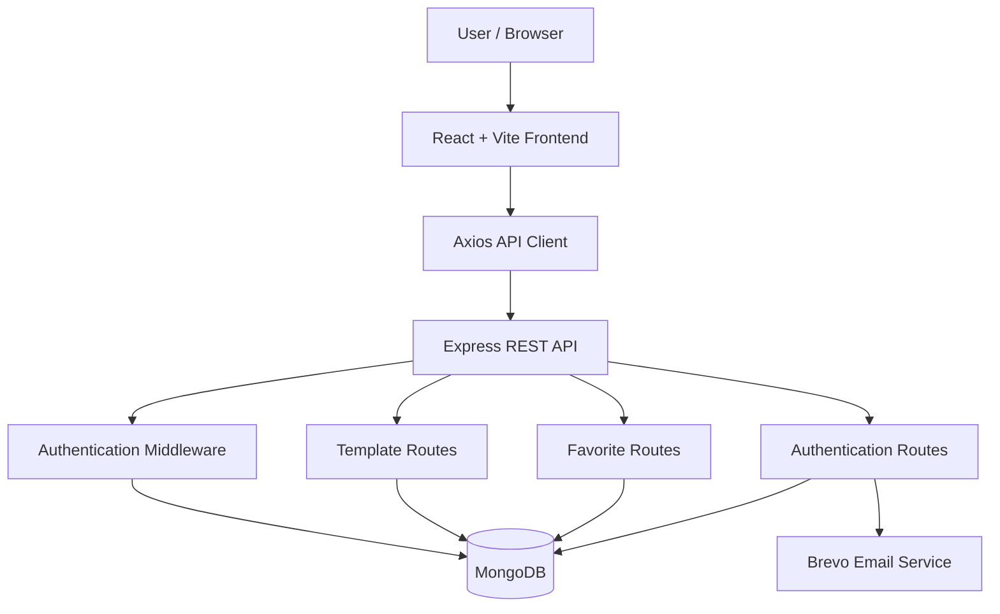
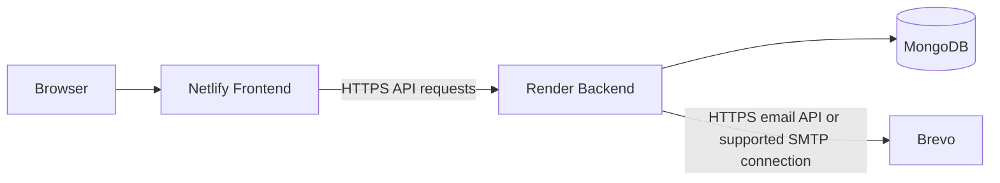
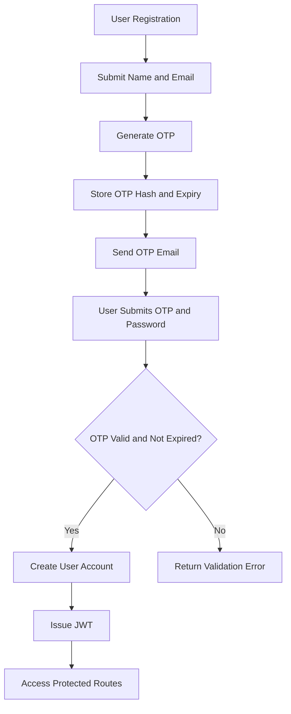
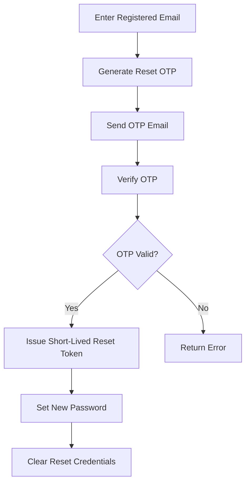

# fullstack-intern-task
# TemplateHub — Mini SaaS Template Store

A full-stack template marketplace built with React, Node.js, Express, and MongoDB. TemplateHub allows users to explore templates, view detailed information, manage favorites, and authenticate securely using email OTP verification.

## 🎥 Project Demo

**YouTube Demo (Unlisted):**  
https://youtu.be/XorOYe6xslY

The demonstration covers the application's main features, authentication workflow, template browsing, favorites, and deployment behavior.

## ⚠️ Important Deployment Limitation — Render Free Tier

**Email OTP delivery through SMTP is restricted on Render's free web services.**

During deployment, the application encountered an SMTP connection timeout when attempting to send registration and password-reset OTP emails through Brevo:

```text
ETIMEDOUT
command: CONN
message: Connection timeout
```

The application worked with SMTP locally, but the deployed backend could not establish the SMTP connection.

### Why does this happen?

Render's free web services block outbound SMTP traffic on ports **25, 465, and 587**. Therefore, an application relying on direct SMTP connections may fail to deliver OTP emails when deployed on the free tier.

### What are the available solutions?

- **Render paid instance:** The documented free-tier SMTP restriction does not apply to paid instance types.
- **HTTPS email API:** Integrate a transactional email provider through its HTTPS API instead of direct SMTP. This avoids the blocked SMTP ports, although provider configuration, account limits, and sender verification still apply.

**Important:** This is a deployment and email-delivery limitation, not proof that the entire application requires a paid server. Template browsing and other API functionality can work on the free tier when correctly configured. Email delivery must be tested separately.

The deployed application should be evaluated according to the currently available backend configuration and its actual runtime behavior.

##  Features

### Authentication and Account Management

- User registration with email OTP verification.
- Secure password hashing.
- JWT-based authentication.
- Login and logout.
- Forgot-password workflow with email OTP verification.
- Password reset using a time-limited reset token.
- Authenticated user profile retrieval.
- Change-password functionality.
- OTP expiration and attempt limits.

### Template Marketplace

- Browse available templates.
- Paginated template listing.
- View detailed template information.
- Search and filter templates, where implemented.
- View template features, included pages, use cases, technology stack, and tags.
- Explore template preview images.
- Add templates to favorites and manage saved items.

### Backend and Security

- RESTful API architecture.
- MongoDB integration using Mongoose.
- Environment-based configuration.
- Authentication middleware for protected routes.
- CORS configuration for frontend-backend communication.
- Security headers and API rate limiting, where configured.
- Centralized error handling within application workflows.

## 🛠️ Technology Stack

| Layer | Technologies |
|---|---|
| Frontend | React, Vite, JavaScript, CSS |
| API communication | Axios |
| Backend | Node.js, Express.js |
| Database | MongoDB, Mongoose |
| Authentication | JWT, password hashing |
| Email | Brevo transactional email service |
| Deployment | Netlify (frontend), Render (backend) |
| Version control | Git, GitHub |

## 🏗️ Architecture



### Deployment Architecture



**Deployment URLs**

- Frontend: https://template-hub-gnxtace.netlify.app
- Backend: https://saas-backend-1-ycpu.onrender.com

The backend root endpoint returns a status message confirming that the API is running. Individual endpoints and external integrations should be tested independently.

## 🔐 Authentication Flow



### Password Reset Flow



## 🔌 API Documentation

Base URL:

```text
Local:      http://localhost:5000/api
Production: https://saas-backend-1-jrw2.onrender.com
```

### Authentication — `/api/auth`

| Method | Endpoint | Description | Access |
|---|---|---|---|
| POST | `/register/request-otp` | Request registration OTP | Public |
| POST | `/register/verify-otp` | Verify OTP and complete registration | Public |
| POST | `/login` | Authenticate user | Public |
| POST | `/forgot-password` | Request password-reset OTP | Public |
| POST | `/verify-reset-otp` | Verify reset OTP and obtain reset token | Public |
| POST | `/reset-password` | Set a new password | Reset token |
| GET | `/me` | Retrieve authenticated user information | Protected |
| POST | `/change-password` | Change the authenticated user's password | Protected |

Protected endpoints require:

```http
Authorization: Bearer <JWT_TOKEN>
```

Registration and password-reset OTPs are time-limited. OTP attempt limits and token expiration are enforced by the backend.

### Templates — `/api/templates`

| Method | Endpoint | Description | Access |
|---|---|---|---|
| GET | `/` | Retrieve paginated templates | Public |
| GET | `/:id` | Retrieve a template by ID | Public |

Example pagination request:

```http
GET /api/templates?page=1&limit=6
```

The listing response includes template data and pagination metadata, such as the current page, page size, total templates, total pages, and whether previous or next pages exist.

### Favorites — `/api/favorites`

| Method | Endpoint | Description | Access |
|---|---|---|---|
| GET | `/` | Retrieve the user's favorites | Protected |
| POST | `/` | Add a template to favorites | Protected |
| DELETE | `/:templateId` | Remove a template from favorites | Protected |

Favorite endpoints require a valid authenticated user's JWT. The precise request body and response format should be verified against the implemented favorite routes.

## 📁 Project Structure

```text
templatehub/
├── frontend/
│   ├── src/
│   │   ├── api/
│   │   │   └── axios.js
│   │   ├── components/
│   │   ├── pages/
│   │   ├── App.jsx
│   │   └── main.jsx
│   ├── package.json
│   └── .env.example
│
├── backend/
│   ├── config/
│   │   └── db.js
│   ├── controllers/
│   ├── middleware/
│   ├── models/
│   ├── routes/
│   │   ├── authRoutes.js
│   │   ├── templateRoutes.js
│   │   └── favouriteRoutes.js
│   ├── utils/
│   │   └── sendOtpEmail.js
│   ├── server.js
│   ├── package.json
│   └── .env.example
│
└── README.md
```

*The structure above illustrates the main application areas. Keep the file names and folders aligned with the actual repository.*

## ⚙️ Local Setup

### Prerequisites

- Node.js 18 or later.
- npm.
- A MongoDB instance or MongoDB Atlas database.
- A Brevo account if email OTP delivery is enabled.

### 1. Clone the repository

```bash
git clone <YOUR_GITHUB_REPOSITORY_URL>
cd <YOUR_PROJECT_DIRECTORY>
```

### 2. Configure the backend

```bash
cd backend
npm install
```

Create `backend/.env` using the following template:

```env
PORT=5000
MONGODB_URI=your_mongodb_connection_string
JWT_SECRET=your_long_random_secret
FRONTEND_URL=http://localhost:5173

# Use these when integrating Brevo's HTTPS email API
BREVO_API_KEY=your_brevo_api_key
BREVO_FROM_EMAIL=your_verified_sender_email
```

Use the environment variable names expected by the actual implementation. Never commit real credentials to GitHub.

Start the backend:

```bash
npm run dev
```

If a development script is not configured, use the start command provided by the backend's `package.json`.

### 3. Configure the frontend

Open a new terminal:

```bash
cd frontend
npm install
```

Configure the frontend API base URL according to the environment. For example, if the Axios client uses a Vite environment variable:

```env
VITE_API_BASE_URL=http://localhost:5000/api
```

The Axios configuration must read the same variable name. For production, set it to:

```text
https://saas-backend-1-ycpu.onrender.com/api
```

Start the frontend:

```bash
npm run dev
```

Open the local URL printed by Vite, usually `http://localhost:5173`.

## 🌐 Deployment Configuration

### Frontend — Netlify

- Connect the frontend repository or deploy the frontend build.
- Configure the production API base URL.
- Ensure client-side routes work after page refreshes.
- Redeploy after changing frontend environment variables.

### Backend — Render

- Connect the backend repository.
- Set the correct root directory if the repository contains separate frontend and backend folders.
- Configure the build and start commands according to `backend/package.json`.
- Add the MongoDB connection string, JWT secret, and email-provider credentials under Environment.
- Allow the exact frontend origin in the CORS configuration.
- Review deployment logs and test API endpoints after deployment.

### Email delivery

The deployed email provider must use a delivery method supported by the hosting environment. On Render's free tier, direct SMTP connections on ports 25, 465, and 587 are blocked. An HTTPS-based transactional email API is an alternative, provided the API key, verified sender, and provider account are configured correctly.

## 🧪 Testing Checklist

- [ ] Backend starts and connects to MongoDB.
- [ ] Template listing returns paginated results.
- [ ] Template detail endpoint returns the requested template.
- [ ] Registration OTP request works.
- [ ] Registration OTP verification creates an account.
- [ ] Login returns a valid JWT.
- [ ] Protected endpoints reject missing or invalid tokens.
- [ ] Favorites can be added, retrieved, and removed.
- [ ] Password-reset OTP and reset-token workflows work.
- [ ] Frontend communicates with the deployed backend without CORS errors.
- [ ] Email delivery is verified using provider logs and a real recipient inbox.

## 🔒 Security Notes

- Keep API keys, database credentials, and JWT secrets in environment variables.
- Never expose backend secrets in frontend environment variables.
- Do not log OTP values or authentication tokens.
- Validate request data and handle invalid or expired tokens.
- Use HTTPS for production API communication.
- Configure CORS and rate limits to match the application's deployment and usage.
- Verify email delivery independently from the success of the OTP-generation logic.

## 🚀 Future Improvements

- Automated tests for API endpoints and authentication workflows.
- Improved template discovery and filtering.
- Administrative template management.
- Better email delivery monitoring and retry handling.
- More detailed deployment health checks and logging.

## 👨‍💻 Author

**Jai Aakash**

- Email: jaiaakash57@gmail.com
- Phone: 6369871904
- Portfolio: https://jaiaakashporfolio.netlify.app/
- GitHub: https://github.com/JaiAakash2005

---

Built as a full-stack Mini SaaS Template Store project, demonstrating frontend development, REST API design, database integration, authentication, and deployment troubleshooting.
